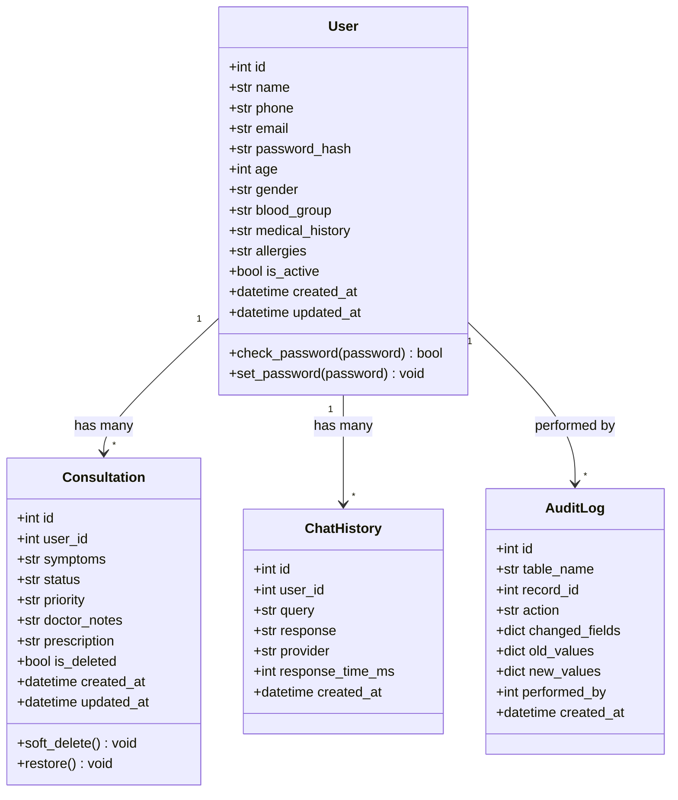
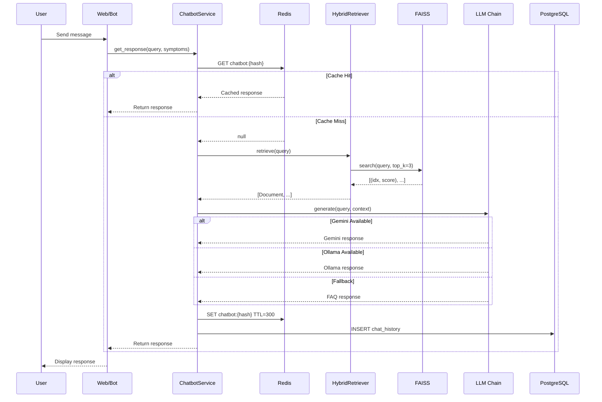
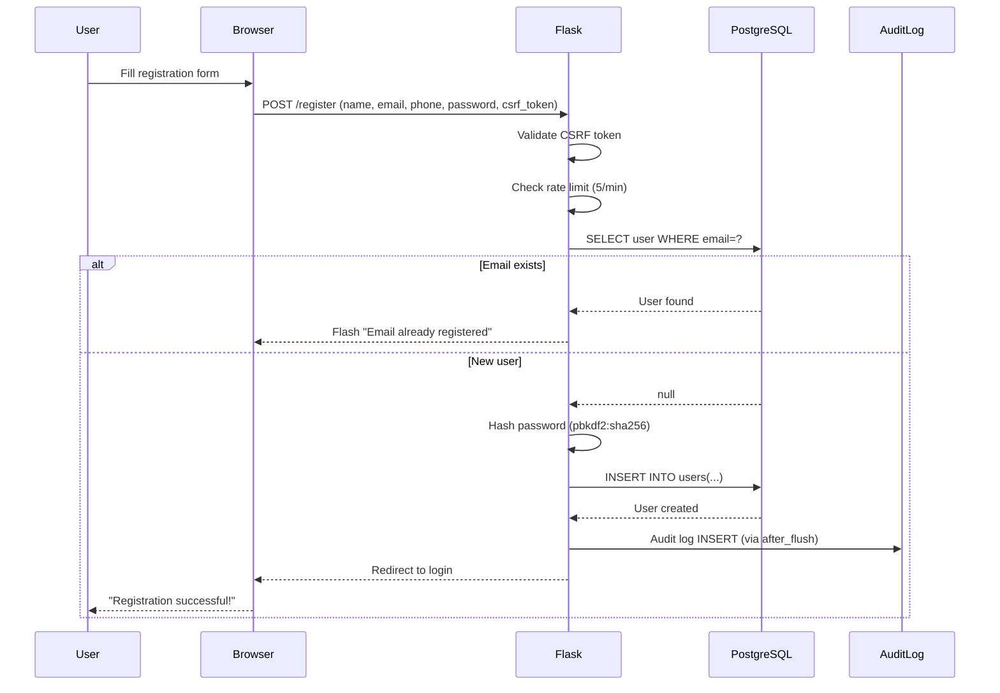

# 🔬 Low-Level Design (LLD) — Docify v2

> Module-level design with class diagrams, function signatures, data flow, and implementation details.

---

## 1. Class Diagram



---

## 2. Module Design

### 2.1 App Factory (`app/__init__.py`)

```python
def create_app(config_class: type = None) -> Flask:
    """
    Application factory that:
    1. Loads environment (.env)
    2. Creates Flask instance
    3. Applies config (Dev/Prod/Test)
    4. Initializes extensions (db, migrate, cache, csrf, limiter)
    5. Registers blueprints (main, auth, dashboard, chatbot, api)
    6. Registers middleware (ip_filter, security_headers)
    7. Registers error handlers (403, 404, 500)
    8. Creates database tables
    
    Returns: Configured Flask application
    """
```

### 2.2 Configuration (`app/config.py`)

```python
class BaseConfig:
    SECRET_KEY: str                     # From env, with fallback
    SQLALCHEMY_DATABASE_URI: str        # PostgreSQL URI from DATABASE_URL
    SQLALCHEMY_TRACK_MODIFICATIONS: bool = False
    
    # Redis
    REDIS_URL: str                      # redis://localhost:6379/0
    CACHE_TYPE: str = 'RedisCache'
    CACHE_REDIS_URL: str               # Same as REDIS_URL
    CACHE_DEFAULT_TIMEOUT: int = 300
    
    # Session Security
    SESSION_COOKIE_HTTPONLY: bool = True
    SESSION_COOKIE_SAMESITE: str = 'Lax'
    SESSION_COOKIE_SECURE: bool        # True in production
    
    # Rate Limiting
    RATELIMIT_STORAGE_URI: str         # redis://...
    RATELIMIT_DEFAULT: str = '200 per day;50 per hour'
    
    # CSRF
    WTF_CSRF_TIME_LIMIT: int = 3600

class DevConfig(BaseConfig):
    SQLALCHEMY_DATABASE_URI = 'sqlite:///instance/docify.db'
    CACHE_TYPE = 'SimpleCache'
    SESSION_COOKIE_SECURE = False

class ProdConfig(BaseConfig):
    SESSION_COOKIE_SECURE = True
```

### 2.3 Extensions (`app/extensions.py`)

```python
from flask_sqlalchemy import SQLAlchemy
from flask_migrate import Migrate
from flask_caching import Cache
from flask_wtf import CSRFProtect
from flask_limiter import Limiter
from flask_limiter.util import get_remote_address
from celery import Celery

db = SQLAlchemy()
migrate = Migrate()
cache = Cache()
csrf = CSRFProtect()
limiter = Limiter(key_func=get_remote_address)
celery = Celery()

def init_celery(app: Flask, celery_app: Celery) -> Celery:
    """Configure Celery with Flask app context"""
    celery_app.conf.update(
        broker_url=app.config['REDIS_URL'],
        result_backend=app.config['REDIS_URL'],
    )
    
    class ContextTask(celery_app.Task):
        def __call__(self, *args, **kwargs):
            with app.app_context():
                return self.run(*args, **kwargs)
    
    celery_app.Task = ContextTask
    return celery_app
```

---

## 3. Database Models (Detailed)

### 3.1 User Model

```python
class User(db.Model):
    __tablename__ = 'users'
    
    id = db.Column(db.Integer, primary_key=True)
    name = db.Column(db.String(100), nullable=False)
    phone = db.Column(db.String(15), nullable=False)
    email = db.Column(db.String(120), unique=True, nullable=False, index=True)
    password_hash = db.Column(db.String(200), nullable=False)
    age = db.Column(db.Integer)
    gender = db.Column(db.String(10))
    blood_group = db.Column(db.String(5))
    medical_history = db.Column(db.Text)
    allergies = db.Column(db.Text)
    is_active = db.Column(db.Boolean, default=True, nullable=False)
    created_at = db.Column(db.DateTime, default=datetime.utcnow)
    updated_at = db.Column(db.DateTime, default=datetime.utcnow, onupdate=datetime.utcnow)
    
    # Relationships
    consultations = db.relationship('Consultation', backref='user', lazy='dynamic')
    chat_logs = db.relationship('ChatHistory', backref='user', lazy='dynamic')
    
    # Bot linking
    telegram_id = db.Column(db.BigInteger, unique=True, nullable=True)
    discord_id = db.Column(db.BigInteger, unique=True, nullable=True)
    whatsapp_phone = db.Column(db.String(15), unique=True, nullable=True)
    
    def set_password(self, password: str) -> None:
        self.password_hash = generate_password_hash(password, method='pbkdf2:sha256')
    
    def check_password(self, password: str) -> bool:
        return check_password_hash(self.password_hash, password)
    
    def generate_jwt(self, expires_in: int = 86400) -> str:
        payload = {
            'user_id': self.id,
            'exp': datetime.utcnow() + timedelta(seconds=expires_in)
        }
        return jwt.encode(payload, current_app.config['SECRET_KEY'], algorithm='HS256')
    
    @staticmethod
    def verify_jwt(token: str) -> Optional['User']:
        try:
            payload = jwt.decode(token, current_app.config['SECRET_KEY'], algorithms=['HS256'])
            return User.query.get(payload['user_id'])
        except jwt.InvalidTokenError:
            return None
```

### 3.2 Consultation Model

```python
class Consultation(db.Model):
    __tablename__ = 'consultations'
    
    id = db.Column(db.Integer, primary_key=True)
    user_id = db.Column(db.Integer, db.ForeignKey('users.id', ondelete='CASCADE'), nullable=False)
    symptoms = db.Column(db.Text, nullable=False)
    status = db.Column(
        db.String(20), default='pending', nullable=False,
        # PostgreSQL CHECK constraint
        # info={'check_constraint': "status IN ('pending','in_review','completed','cancelled')"}
    )
    priority = db.Column(
        db.String(10), default='normal', nullable=False,
    )
    doctor_notes = db.Column(db.Text)
    prescription = db.Column(db.Text)
    is_deleted = db.Column(db.Boolean, default=False, nullable=False, index=True)
    created_at = db.Column(db.DateTime, default=datetime.utcnow, index=True)
    updated_at = db.Column(db.DateTime, default=datetime.utcnow, onupdate=datetime.utcnow)
    
    def soft_delete(self) -> None:
        self.is_deleted = True
        self.updated_at = datetime.utcnow()
    
    def restore(self) -> None:
        self.is_deleted = False
        self.updated_at = datetime.utcnow()
    
    @classmethod
    def active(cls):
        """Query filter for non-deleted consultations"""
        return cls.query.filter_by(is_deleted=False)
```

### 3.3 Audit Log Model

```python
class AuditLog(db.Model):
    __tablename__ = 'audit_logs'
    
    id = db.Column(db.Integer, primary_key=True)
    table_name = db.Column(db.String(50), nullable=False, index=True)
    record_id = db.Column(db.Integer, nullable=False)
    action = db.Column(db.String(20), nullable=False)  # INSERT, UPDATE, SOFT_DELETE, HARD_DELETE
    changed_fields = db.Column(db.JSON)      # PostgreSQL JSONB
    old_values = db.Column(db.JSON)          # PostgreSQL JSONB
    new_values = db.Column(db.JSON)          # PostgreSQL JSONB
    performed_by = db.Column(db.Integer, db.ForeignKey('users.id'), nullable=True)
    created_at = db.Column(db.DateTime, default=datetime.utcnow, index=True)
```

### 3.4 Audit Event Listener

```python
@event.listens_for(db.Session, "after_flush")
def audit_session_changes(session, flush_context):
    """Automatic audit logging on every database flush"""
    
    for obj in session.new:
        if isinstance(obj, (User, Consultation)):
            audit = AuditLog(
                table_name=obj.__tablename__,
                record_id=obj.id,
                action='INSERT',
                new_values=_serialize(obj),
                performed_by=_get_current_user_id()
            )
            session.add(audit)
    
    for obj in session.dirty:
        if isinstance(obj, (User, Consultation)):
            state = db.inspect(obj)
            changes = {}
            old_vals = {}
            new_vals = {}
            
            for attr in state.attrs:
                hist = attr.load_history()
                if hist.has_changes():
                    changes[attr.key] = True
                    old_vals[attr.key] = hist.deleted[0] if hist.deleted else None
                    new_vals[attr.key] = hist.added[0] if hist.added else None
            
            action = 'SOFT_DELETE' if changes.get('is_deleted') and obj.is_deleted else 'UPDATE'
            
            audit = AuditLog(
                table_name=obj.__tablename__,
                record_id=obj.id,
                action=action,
                changed_fields=changes,
                old_values=old_vals,
                new_values=new_vals,
                performed_by=_get_current_user_id()
            )
            session.add(audit)
```

---

## 4. Chatbot Module Design

### 4.1 Embedding Pipeline

```python
# chatbot/embeddings.py

class EmbeddingEngine:
    """Lazy-loaded sentence transformer for text embedding"""
    
    _model = None  # Class-level cache
    
    @classmethod
    def get_model(cls) -> Optional[SentenceTransformer]:
        if cls._model is None:
            try:
                from sentence_transformers import SentenceTransformer
                cls._model = SentenceTransformer(
                    'sentence-transformers/all-MiniLM-L6-v2',
                    device='cpu'
                )
            except ImportError:
                return None
        return cls._model
    
    @classmethod
    def embed(cls, texts: list[str]) -> Optional[np.ndarray]:
        model = cls.get_model()
        if model is None:
            return None
        embeddings = model.encode(texts, normalize_embeddings=True)
        return np.asarray(embeddings, dtype='float32')
```

### 4.2 FAISS Vector Store

```python
# chatbot/vectorstore.py

class FAQVectorStore:
    """FAISS-based vector store with disk persistence and hash validation"""
    
    def __init__(self, index_dir: str = 'instance/'):
        self.index: Optional[faiss.Index] = None
        self.docs: list[str] = []
        self.index_path = os.path.join(index_dir, 'faq_faiss.idx')
        self.meta_path = os.path.join(index_dir, 'faq_faiss.json')
    
    def load_or_build(self, docs: list[str], source_hash: str) -> bool:
        """Load cached index or build new one"""
        self.docs = docs
        
        # Try loading cached index
        if self._load_cache(source_hash):
            return True
        
        # Build new index
        return self._build_index(source_hash)
    
    def _build_index(self, source_hash: str) -> bool:
        vectors = EmbeddingEngine.embed(self.docs)
        if vectors is None:
            return False
        
        dimension = vectors.shape[1]  # 384 for MiniLM
        self.index = faiss.IndexFlatIP(dimension)
        self.index.add(np.ascontiguousarray(vectors))
        
        # Persist to disk
        faiss.write_index(self.index, self.index_path)
        with open(self.meta_path, 'w') as f:
            json.dump({'hash': source_hash, 'count': len(self.docs)}, f)
        
        return True
    
    def search(self, query: str, top_k: int = 3) -> list[tuple[int, float]]:
        """Search for similar documents, returns [(doc_index, score)]"""
        query_vec = EmbeddingEngine.embed([query])
        if query_vec is None or self.index is None:
            return []
        
        scores, indices = self.index.search(
            np.ascontiguousarray(query_vec), top_k
        )
        return [
            (int(idx), float(score))
            for score, idx in zip(scores[0], indices[0])
            if idx != -1
        ]
```

### 4.3 Hybrid Retriever

```python
# chatbot/retriever.py

class HybridRetriever:
    """Combines keyword and semantic search with configurable rank fusion"""
    
    def __init__(self, docs: list[str], vector_store: FAQVectorStore,
                 keyword_weight: float = 0.6):
        self.docs = docs
        self.vector_store = vector_store
        self.keyword_weight = keyword_weight
        self.embedding_weight = 1.0 - keyword_weight
    
    def retrieve(self, query: str, top_k: int = 3) -> list[Document]:
        # 1. Keyword scores (TF-IDF → simple overlap fallback)
        kw_scores = tfidf_scores(query, self.docs)
        if kw_scores is None:
            kw_scores = simple_overlap_scores(query, self.docs)
        
        # 2. Embedding scores (FAISS search)
        emb_scores = [0.0] * len(self.docs)
        for idx, score in self.vector_store.search(query, top_k=len(self.docs)):
            if 0 <= idx < len(emb_scores):
                emb_scores[idx] = score
        
        # 3. Rank fusion
        combined = [
            self.keyword_weight * kw + self.embedding_weight * emb
            for kw, emb in zip(kw_scores, emb_scores)
        ]
        
        # 4. Top-K selection
        top_indices = sorted(range(len(combined)),
                           key=lambda i: combined[i], reverse=True)[:top_k]
        
        return [
            Document(content=self.docs[i], score=combined[i], source='faq')
            for i in top_indices if combined[i] > 0
        ]
```

### 4.4 LLM Provider Chain

```python
# chatbot/responder.py

class ResponseChain:
    """Hierarchical LLM provider with graceful failover"""
    
    PROVIDERS = [
        ('gemini', '_call_gemini'),
        ('ollama', '_call_ollama'),
        ('huggingface', '_call_huggingface'),
        ('fallback', '_call_fallback'),
    ]
    
    def generate(self, query: str, context: str, symptoms: str = None) -> tuple[str, str]:
        """
        Returns: (response_text, provider_name)
        Tries each provider in order until one succeeds.
        """
        # Check rule-based first (zero latency)
        rule_response = rule_based_response(query)
        if rule_response:
            return rule_response, 'rule_based'
        
        prompt = self._build_prompt(query, context, symptoms)
        
        for provider_name, method_name in self.PROVIDERS:
            try:
                method = getattr(self, method_name)
                response = method(prompt)
                if response and response.strip():
                    return response.strip(), provider_name
            except Exception:
                continue  # Try next provider
        
        return self._hardcoded_fallback(), 'hardcoded'
    
    def _call_gemini(self, prompt: str) -> str:
        """Google Gemini API call"""
        import google.generativeai as genai
        genai.configure(api_key=os.environ['GEMINI_API_KEY'])
        model = genai.GenerativeModel('gemini-1.5-flash',
                                       system_instruction=SYSTEM_INSTRUCTION)
        response = model.generate_content(prompt)
        return response.text
    
    def _call_ollama(self, prompt: str) -> str:
        """Local Ollama REST API call"""
        resp = requests.post(
            f"{OLLAMA_BASE_URL}/api/generate",
            json={'model': OLLAMA_MODEL, 'prompt': prompt, 'stream': False},
            timeout=5
        )
        resp.raise_for_status()
        return resp.json().get('response', '')
    
    def _call_huggingface(self, prompt: str) -> str:
        """Local HuggingFace CPU inference"""
        from transformers import pipeline
        pipe = pipeline('text-generation', model='TinyLlama/TinyLlama-1.1B-Chat-v1.0',
                       device='cpu', max_new_tokens=200)
        return pipe(prompt)[0]['generated_text']
    
    def _call_fallback(self, prompt: str) -> str:
        """Zero-dependency FAQ matching"""
        return best_faq_block(prompt) or ''
```

---

## 5. Bot Module Design

### 5.1 Telegram Bot

```python
# bots/telegram_bot.py

class DocifyTelegramBot:
    def __init__(self, token: str, chatbot_service):
        self.app = Application.builder().token(token).build()
        self.chatbot = chatbot_service
        self._register_handlers()
    
    def _register_handlers(self):
        self.app.add_handler(CommandHandler('start', self.cmd_start))
        self.app.add_handler(CommandHandler('ask', self.cmd_ask))
        self.app.add_handler(CommandHandler('consult', self.cmd_consult))
        self.app.add_handler(CommandHandler('status', self.cmd_status))
        self.app.add_handler(CommandHandler('link', self.cmd_link))
        self.app.add_handler(MessageHandler(filters.TEXT, self.handle_message))
    
    async def cmd_ask(self, update, context):
        """Handle /ask <question>"""
        query = ' '.join(context.args)
        if not query:
            await update.message.reply_text("Usage: /ask <your question>")
            return
        
        response = self.chatbot.get_response(query)
        await update.message.reply_text(response or "No answer available.")
    
    async def cmd_consult(self, update, context):
        """Handle /consult <symptoms> — creates consultation"""
        user = self._get_linked_user(update.effective_user.id)
        if not user:
            await update.message.reply_text("Link your account first: /link <email> <token>")
            return
        
        symptoms = ' '.join(context.args)
        consultation = Consultation(user_id=user.id, symptoms=symptoms)
        db.session.add(consultation)
        db.session.commit()
        
        await update.message.reply_text(
            f"✅ Consultation #{consultation.id} created!\n"
            f"Status: {consultation.status}"
        )
```

### 5.2 Bot Authentication

```python
# bots/bot_auth.py

class BotAuthService:
    """JWT-based authentication for bot users"""
    
    def __init__(self, redis_client):
        self.redis = redis_client
    
    def link_user(self, platform: str, platform_id: int, email: str, token: str) -> bool:
        """Link external platform account to Docify user"""
        user = User.verify_jwt(token)
        if not user or user.email != email:
            return False
        
        field_map = {
            'telegram': 'telegram_id',
            'discord': 'discord_id',
            'whatsapp': 'whatsapp_phone',
        }
        
        setattr(user, field_map[platform], platform_id)
        db.session.commit()
        
        # Cache the mapping in Redis
        self.redis.setex(
            f"bot:{platform}:{platform_id}",
            86400,  # 24 hour TTL
            str(user.id)
        )
        return True
    
    def get_user(self, platform: str, platform_id: int) -> Optional[User]:
        """Look up Docify user from platform ID"""
        # Check Redis cache first
        cached = self.redis.get(f"bot:{platform}:{platform_id}")
        if cached:
            return User.query.get(int(cached))
        
        # Fall back to database
        field_map = {
            'telegram': User.telegram_id,
            'discord': User.discord_id,
        }
        
        user = User.query.filter(field_map[platform] == platform_id).first()
        if user:
            self.redis.setex(f"bot:{platform}:{platform_id}", 86400, str(user.id))
        return user
```

---

## 6. Redis Caching Layer

```python
# app/services/chatbot_service.py

class CachedChatbotService:
    """Redis-cached wrapper around the chatbot RAG engine"""
    
    def __init__(self, cache, chatbot_engine):
        self.cache = cache  # Flask-Caching instance (Redis backend)
        self.engine = chatbot_engine
    
    def get_response(self, query: str, symptoms: str = None) -> Optional[str]:
        # 1. Build cache key
        cache_key = f"chatbot:{hashlib.md5((query + (symptoms or '')).encode()).hexdigest()}"
        
        # 2. Check cache
        cached = self.cache.get(cache_key)
        if cached:
            return cached
        
        # 3. Generate response
        response, provider = self.engine.generate(query, symptoms)
        
        # 4. Cache with TTL
        if response:
            self.cache.set(cache_key, response, timeout=300)
        
        # 5. Log to database (async via Celery)
        log_chat.delay(
            user_id=_get_current_user_id(),
            query=query,
            response=response,
            provider=provider
        )
        
        return response
```

---

## 7. API Endpoint Signatures

```python
# app/routes/api.py

@api_bp.route('/v1/auth/token', methods=['POST'])
def issue_token():
    """POST {email, password} → {token, expires_in}"""

@api_bp.route('/v1/consultations', methods=['GET'])
@jwt_required
def list_consultations():
    """GET → {consultations: [...], page, total}"""

@api_bp.route('/v1/consultations', methods=['POST'])
@jwt_required
def create_consultation():
    """POST {symptoms, priority?} → {id, status}"""

@api_bp.route('/v1/consultations/<int:id>', methods=['GET'])
@jwt_required
def get_consultation(id):
    """GET → {id, symptoms, status, doctor_notes, ...}"""

@api_bp.route('/v1/chat', methods=['POST'])
@jwt_required
@limiter.limit('10 per minute')
def chat():
    """POST {message, symptoms?} → {reply, provider}"""

@api_bp.route('/v1/health', methods=['GET'])
def health():
    """GET → {status, components: {db, redis, faiss, ...}}"""
```

---

## 8. Sequence Diagrams

### 8.1 Chatbot Request Flow



### 8.2 User Registration Flow


