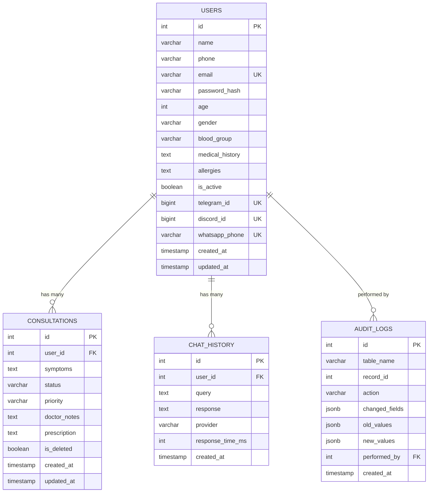

# 📐 System Design Document — Docify v2

> Complete system design covering architecture, components, data flow, scaling, and trade-offs.

---

## 1. Problem Statement

Build a secure, scalable medical consultation platform where:
- **Patients** register, submit symptoms, and interact with an AI chatbot for medical guidance
- **Doctors** review consultations and provide notes/prescriptions
- An **AI chatbot** answers health and platform questions using RAG (Retrieval-Augmented Generation)
- The system is accessible via **web**, **Telegram**, **WhatsApp**, and **Discord**
- Everything works even when AI services are offline (graceful degradation)

---

## 2. Functional Requirements

| ID | Requirement | Priority |
|----|------------|----------|
| FR1 | User registration with email/password | P0 |
| FR2 | User login/logout with session management | P0 |
| FR3 | Medical profile management (age, gender, blood group, allergies, history) | P1 |
| FR4 | Consultation CRUD with soft deletes | P0 |
| FR5 | AI chatbot with FAQ + medical guidance | P0 |
| FR6 | Chatbot accessible via web, Telegram, WhatsApp, Discord | P1 |
| FR7 | Consultation status tracking (pending → in_review → completed) | P1 |
| FR8 | Doctor notes and prescription management | P1 |
| FR9 | Chat history logging and retrieval | P2 |
| FR10 | Audit trail for all data changes | P1 |
| FR11 | CSV export of user data | P2 |
| FR12 | Pagination on dashboard listings | P1 |

---

## 3. Non-Functional Requirements

| ID | Requirement | Target |
|----|------------|--------|
| NFR1 | Response time for chatbot | < 2 seconds (cached: < 50ms) |
| NFR2 | System availability | 99.5% uptime |
| NFR3 | Concurrent users | 100+ simultaneous |
| NFR4 | Cold start time | < 5 seconds (web), < 10s (AI-enabled) |
| NFR5 | Security | OWASP Top 10 mitigations |
| NFR6 | Data durability | PostgreSQL with daily backups |
| NFR7 | Graceful degradation | All features work without AI dependencies |
| NFR8 | Zero-downtime deployments | Rolling updates via Docker |

---

## 4. Technology Selection & Justification

### 4.1 Backend Framework: Flask

| Alternative | Why Not Chosen |
|-------------|---------------|
| Django | Too heavy for this scale; don't need admin, ORM auto-discovery |
| FastAPI | Async adds complexity for a primarily synchronous CRUD + RAG app |
| Express.js | Python ecosystem is essential for ML/AI pipeline |

**Flask wins** because: lightweight, explicit, excellent extension ecosystem, Flask Factory pattern for clean architecture.

### 4.2 Database: PostgreSQL

| Alternative | Why Not Chosen |
|-------------|---------------|
| SQLite | No concurrent writes, no JSONB, no CHECK constraints |
| MySQL | Weaker JSON support, no native JSONB |
| MongoDB | Relational data (users ↔ consultations) fits RDBMS better |

**PostgreSQL wins** because: JSONB for audit logs, CHECK constraints, concurrent access, battle-tested reliability.

### 4.3 Cache: Redis

| Alternative | Why Not Chosen |
|-------------|---------------|
| Memcached | No persistence, no pub/sub, can't serve as Celery broker |
| In-memory (SimpleCache) | Not shared across workers, lost on restart |

**Redis wins** because: single service handles caching, sessions, rate limits, Celery broker, and bot token store.

### 4.4 Vector Search: FAISS

| Alternative | Why Not Chosen |
|-------------|---------------|
| pgvector | Adds PostgreSQL dependency to chatbot; slower at small scale |
| Pinecone/Weaviate | External dependency, cost, overkill for < 10K documents |
| ChromaDB | Heavier, more dependencies |

**FAISS wins** because: fastest for small datasets, runs entirely in-process, disk-persistent, works offline.

### 4.5 Embedding Model: all-MiniLM-L6-v2

| Alternative | Why Not Chosen |
|-------------|---------------|
| OpenAI embeddings | API cost, requires internet |
| BGE-large | 1024-dim vectors, 3x memory usage |
| all-mpnet-base-v2 | 768-dim, slower inference on CPU |

**MiniLM wins** because: 384-dim (memory efficient), fast CPU inference (< 50ms per query), excellent quality for FAQ-scale retrieval.

---

## 5. Data Model

### 5.1 Entity-Relationship Diagram



### 5.2 Index Strategy

| Table | Column(s) | Type | Purpose |
|-------|-----------|------|---------|
| users | email | UNIQUE B-tree | Login lookup |
| users | telegram_id | UNIQUE B-tree | Bot user lookup |
| users | discord_id | UNIQUE B-tree | Bot user lookup |
| consultations | (user_id, is_deleted) | Composite B-tree | Dashboard query |
| consultations | created_at | B-tree | Ordering |
| chat_history | (user_id, created_at) | Composite B-tree | History retrieval |
| audit_logs | (table_name, record_id) | Composite B-tree | Audit lookup |
| audit_logs | created_at | B-tree | Time-range queries |

---

## 6. API Design

### 6.1 Web Routes (Server-Side Rendered)

| Method | Path | Auth | Description |
|--------|------|------|-------------|
| GET | `/` | No | Landing page |
| GET | `/faq` | No | FAQ page |
| GET | `/health` | No | Health check (JSON) |
| GET/POST | `/register` | No | Registration form |
| GET/POST | `/login` | No | Login form |
| GET | `/logout` | Yes | End session |
| GET/POST | `/dashboard` | Yes | Consultation dashboard |
| GET/POST | `/update_consultation/<id>` | Yes | Edit consultation |
| POST | `/delete_consultation/<id>` | Yes | Soft delete (JSON) |
| GET/POST | `/profile` | Yes | Medical profile |
| POST | `/chatbot` | No* | Chatbot query (JSON) |

### 6.2 REST API Endpoints

| Method | Path | Auth | Description |
|--------|------|------|-------------|
| POST | `/api/v1/auth/token` | No | Issue JWT token |
| GET | `/api/v1/consultations` | JWT | List consultations |
| POST | `/api/v1/consultations` | JWT | Create consultation |
| GET | `/api/v1/consultations/:id` | JWT | Get consultation |
| PATCH | `/api/v1/consultations/:id` | JWT | Update status/notes |
| POST | `/api/v1/chat` | JWT | Chatbot query |
| GET | `/api/v1/health` | No | Component health |

### 6.3 Webhook Endpoints

| Method | Path | Auth | Description |
|--------|------|------|-------------|
| POST | `/webhook/whatsapp` | Twilio signature | WhatsApp incoming messages |

---

## 7. Caching Architecture

```
                    Request
                       │
                       ▼
              ┌────────────────┐
              │   Rate Limit   │◄──── Redis: ratelimit:{ip}:{endpoint}
              │    Check       │
              └───────┬────────┘
                      │
                      ▼
              ┌────────────────┐
              │  Session Auth  │◄──── Redis: session:{session_id}
              │                │
              └───────┬────────┘
                      │
                      ▼
              ┌────────────────┐
              │  Cache Lookup  │◄──── Redis: chatbot:{hash(query+symptoms)}
              │                │
              └───────┬────────┘
                      │
           ┌──────────┴──────────┐
           │                     │
        HIT │                  MISS
           │                     │
           ▼                     ▼
     Return cached          RAG Pipeline
      response              (expensive)
                                │
                                ▼
                          Cache result
                        (TTL = 300s)
                                │
                                ▼
                         Return response
```

### Cache Key Design

| Pattern | TTL | Purpose |
|---------|-----|---------|
| `chatbot:{md5(query+symptoms)}` | 300s | Avoid re-computing expensive RAG responses |
| `session:{session_id}` | 3600s | Server-side session storage |
| `ratelimit:{ip}:{endpoint}` | varies | Shared rate limit counters |
| `faiss:ready` | none | Flag indicating FAISS index is loaded |
| `bot:telegram:{telegram_id}` | 86400s | Telegram→User ID mapping |
| `bot:discord:{discord_id}` | 86400s | Discord→User ID mapping |
| `user:profile:{user_id}` | 600s | Cached user profile data |

---

## 8. Security Architecture

### 8.1 Defense in Depth

```
Layer 1: Network        → Nginx reverse proxy + TLS termination
Layer 2: IP Filter      → CIDR-based allowlisting (middleware)
Layer 3: Rate Limiter   → Per-IP, per-endpoint limits (Redis-backed)
Layer 4: CSRF           → Flask-WTF token validation on POST
Layer 5: Auth           → Session cookies (web) / JWT tokens (API/bots)
Layer 6: Input          → Sanitization + validation on all inputs
Layer 7: Database       → Parameterized queries (SQLAlchemy ORM)
Layer 8: Headers        → X-Content-Type-Options, X-Frame-Options, Referrer-Policy
Layer 9: Cookies        → HTTPOnly, SameSite=Lax, Secure (production)
Layer 10: Audit         → Immutable audit log on all mutations
```

### 8.2 Bot Security
- Each bot verifies JWT tokens linked to Docify accounts
- Telegram: Bot token stored as env var, not in code
- WhatsApp: Twilio request signature validation
- Discord: Guild permission checks, DM isolation
- All bot tokens cached in Redis with 24h TTL

---

## 9. Deployment Architecture

```yaml
# docker-compose.yml (simplified)
services:
  web:
    build: .
    ports: ["5000:5000"]
    depends_on: [db, redis]
    environment:
      DATABASE_URL: postgresql://user:pass@db:5432/docify
      REDIS_URL: redis://redis:6379/0
    deploy:
      replicas: 2
      restart_policy: { condition: on-failure }

  db:
    image: postgres:15-alpine
    volumes: [pgdata:/var/lib/postgresql/data]
    environment:
      POSTGRES_DB: docify
      POSTGRES_USER: docify
      POSTGRES_PASSWORD: ${DB_PASSWORD}
    healthcheck:
      test: ["CMD-SHELL", "pg_isready -U docify"]

  redis:
    image: redis:7-alpine
    volumes: [redisdata:/data]
    command: redis-server --appendonly yes
    healthcheck:
      test: ["CMD", "redis-cli", "ping"]

  worker:
    build: .
    command: celery -A tasks worker --loglevel=info
    depends_on: [db, redis]

  telegram-bot:
    build: .
    command: python bots/telegram_bot.py
    depends_on: [web, redis]

  discord-bot:
    build: .
    command: python bots/discord_bot.py
    depends_on: [web, redis]

volumes:
  pgdata:
  redisdata:
```

---

## 10. Monitoring & Observability

### 10.1 Health Check Endpoint

```json
GET /api/v1/health

{
  "status": "healthy",
  "components": {
    "database": { "status": "up", "latency_ms": 2 },
    "redis": { "status": "up", "latency_ms": 1 },
    "faiss_index": { "status": "loaded", "doc_count": 48 },
    "embedding_model": { "status": "loaded", "model": "all-MiniLM-L6-v2" },
    "celery": { "status": "up", "active_tasks": 0 }
  },
  "version": "2.0.0",
  "uptime_seconds": 86400
}
```

### 10.2 Logging Strategy

| Component | Log Level | Format |
|-----------|-----------|--------|
| Flask routes | INFO | `{timestamp} {level} {endpoint} {method} {status} {latency_ms}` |
| Chatbot | INFO | `{timestamp} {query} {provider} {response_time_ms}` |
| Audit | INFO | `[AUDIT] {action} {table} {record_id} {changed_fields}` |
| Security | WARNING | `{timestamp} IP blocked: {ip} not in {allowed_ranges}` |
| Errors | ERROR | `{timestamp} {exception} {traceback}` |

---

## 11. Trade-offs & Future Improvements

### Current Trade-offs

| Decision | Trade-off |
|----------|-----------|
| FAISS over pgvector | Separate index to manage, but faster and decoupled |
| SQLite dev/PostgreSQL prod | Slight schema mismatch (JSONB ↔ JSON), but simpler dev setup |
| Session auth over JWT-only | Less stateless, but simpler for web UI with forms |
| Sync Flask over async | Simpler code, but limited throughput for I/O-heavy chatbot |

### Future Improvements
1. **WebSocket chat**: Real-time streaming responses instead of request/response
2. **Multi-language support**: FAQ and responses in Hindi, regional languages
3. **Doctor dashboard**: Dedicated admin panel for doctors to manage consultations
4. **Appointment scheduling**: Calendar integration with time slot booking
5. **File uploads**: Lab reports, prescriptions as attachments
6. **Analytics dashboard**: Query patterns, response quality metrics, user engagement
7. **A/B testing**: Compare LLM provider quality and latency
8. **Vector DB migration**: Move to pgvector when dataset grows beyond 100K
